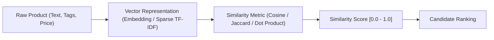
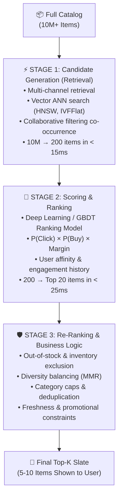

# 🛍️ AI Product Recommendation System: From Similarity Logic to Real-World Architecture

A comprehensive, hands-on, dependency-free reference project covering **Similarity Logic** and the **Multi-Stage Real-World AI Recommendation Funnel**.

---

## 📑 Table of Contents
1. [Core Concept 1: Similarity Logic Deep Dive](#1-core-concept-1-similarity-logic-deep-dive)
   - [Cosine Similarity](#cosine-similarity)
   - [Jaccard Index (Tag & Attribute Overlap)](#jaccard-index)
   - [Euclidean Distance vs. Cosine Similarity](#euclidean-distance-vs-cosine-similarity)
   - [Dot Product & Embeddings](#dot-product--embeddings)
   - [TF-IDF Text Representation](#tf-idf-vectorization)
2. [Core Concept 2: Real-World AI Recommendation System](#2-core-concept-2-real-world-ai-recommendation-system)
   - [The Scaling Problem](#the-scaling-problem-why-naive-similarity-fails)
   - [The 3-Stage Recommendation Funnel](#the-3-stage-recommendation-funnel)
   - [Offline vs. Online Production Architecture](#offline-vs-online-production-architecture)
3. [Project Structure](#3-project-structure)
4. [Quickstart & Runnable Walkthroughs](#4-quickstart--runnable-walkthroughs)
   - [Run the Interactive CLI Demo](#1-run-the-cli-interactive-walkthrough)
   - [Run Automated Tests](#2-run-automated-tests)
   - [Launch the Web Visualizer & API](#3-launch-the-web-ui--rest-api)

---

## 1. Core Concept 1: Similarity Logic Deep Dive

In recommendation systems, "suggesting products" relies on quantifying how close or related two entities are (Item-Item, User-Item, or User-User).



### Cosine Similarity
Cosine similarity evaluates the **cosine of the angle \(\theta\)** between two vectors in multi-dimensional space:

$$\cos(\theta) = \frac{\mathbf{u} \cdot \mathbf{v}}{\|\mathbf{u}\| \|\mathbf{v}\|} = \frac{\sum_{i=1}^n u_i v_i}{\sqrt{\sum_{i=1}^n u_i^2} \sqrt{\sum_{i=1}^n v_i^2}}$$

- **Why it matters:** It is **scale-invariant**. If Product A's description has 20 words and Product B has 200 words but uses similar proportions of vocabulary (e.g. *"wireless", "noise-canceling", "travel"*), their vectors point in the same direction, yielding high cosine similarity.
- **Range:** $[0.0, 1.0]$ for non-negative word/frequency counts.

### Jaccard Index
Used for discrete categorical sets (tags, brands, categories):

$$J(A, B) = \frac{|A \cap B|}{|A \cup B|}$$

- **Example:**
  - Sony Headphones Tags: `{"wireless", "noise-canceling", "over-ear", "bluetooth"}`
  - Bose Headphones Tags: `{"wireless", "noise-canceling", "over-ear", "bluetooth"}`
  - Overlap is 4/4 = **1.0 (100% similarity)**.

### Euclidean Distance vs. Cosine Similarity
$$\text{Euclidean Distance: } d(\mathbf{u}, \mathbf{v}) = \sqrt{\sum_{i=1}^n (u_i - v_i)^2}$$

- **The Difference:** If user 1 rates items with $[1, 2]$ and user 2 rates items with $[2, 4]$:
  - **Cosine similarity = 1.0** (they have the exact same relative preference profile).
  - **Euclidean distance = 2.23** (penalizes user 2 simply for being more generous with higher numbers).
- In recommender systems, **Cosine Similarity** or **Dot Product** is standard for preference profiles.

### Dot Product & Embeddings
$$\mathbf{u} \cdot \mathbf{v} = \sum_{i=1}^n u_i v_i$$
When vectors are unit-normalized ($\|\mathbf{u}\| = 1, \|\mathbf{v}\| = 1$), the dot product is mathematically identical to cosine similarity, enabling extremely fast hardware-accelerated Matrix Multiply (`GEMM`) and GPU vector operations.

### TF-IDF Vectorization
Transforms unstructured text into weighted vectors:
1. **Term Frequency (TF):** $\text{TF}(t, d) = \frac{\text{count}(t \text{ in } d)}{\text{total words in } d}$
2. **Inverse Document Frequency (IDF):** $\text{IDF}(t) = \ln\left(\frac{1 + N}{1 + \text{DF}(t)}\right) + 1$
   - Rare words (e.g. *"noise-canceling"*, *"titanium"*) get high IDF weights.
   - Common words (e.g. *"with"*, *"product"*) get low IDF weights.

---

## 2. Core Concept 2: Real-World AI Recommendation System

### The Scaling Problem: Why Naive Similarity Fails
In an e-commerce platform with **100,000,000 products** and **50,000,000 active users**:
- Pairwise similarity computation requires $O(N)$ operations per request.
- Evaluating a 100-layer neural network across 100M items per user within a **50ms web SLA** is computationally impossible.

### The 3-Stage Recommendation Funnel

Modern production systems (Amazon, Netflix, YouTube, TikTok) divide recommendation into 3 specialized stages:



#### Stage 1: Retrieval (Candidate Generation)
- **Goal:** Filter 10,000,000+ items down to ~100–500 candidates in under 15ms.
- **Channels:**
  1. *Vector ANN Search:* Approximate Nearest Neighbors using HNSW (Hierarchical Navigable Small World) or FAISS.
  2. *Collaborative Co-buy Index:* Precomputed co-occurrence lookup ("Users who bought X also bought Y").
  3. *Inverted Index:* Fast category/brand attribute filtering.

#### Stage 2: Heavy Scoring & Ranking
- **Goal:** Predict explicit user conversion value:
  $$\text{Score} = P(\text{Click}) \times P(\text{Purchase} \mid \text{Click}) \times \text{Expected Value}$$
- Evaluates deep features: user demographics, device, recency of interactions, price sensitivity, and cross-feature interactions.

#### Stage 3: Re-Ranking & Business Rules
- **Inventory Check:** Drops out-of-stock products.
- **Category Diversity (MMR / Maximal Marginal Relevance):** Prevents recommending 5 identical pairs of black headphones; enforces category balancing (e.g., pairs headphones with an adapter or travel charger).
- **De-duplication:** Ensures products already purchased or in the cart are not redundantly recommended.

### Offline vs. Online Production Architecture

```
[ OFFLINE / BATCH PIPELINE ]
  Interactions Lake ──▶ Spark/Airflow ──▶ Model Training (Two-Tower / GBDT)
                                                 │
                                                 ▼
                                     Vector & Feature Embeddings
                                                 │
                                                 ▼
[ NEAR-REAL-TIME / STREAMING ] ────▶ Vector Store (Milvus/Pinecone) & Redis Feature Store
                                                 │
[ ONLINE / LOW-LATENCY SERVING ]                 ▼
  User Request ──────────────▶ API Gateway ──▶ Funnel (Stage 1 ➔ Stage 2 ➔ Stage 3) ──▶ Response
```

---

## 3. Project Structure

```text
recommandation-system/
├── src/
│   ├── similarity.py       # Cosine, Jaccard, Euclidean, Dot Product, TF-IDF Vectorizer
│   ├── content_based.py    # Content-based engine ("Suggest products like this")
│   ├── collaborative.py    # Item-to-item & user-to-item collaborative filtering
│   └── pipeline.py         # Multi-stage production pipeline (Retrieval -> Ranking -> Re-ranking)
├── data/
│   ├── products.json       # Realistic product catalog with categories, tags, ratings, stock
│   └── interactions.json   # User interaction clickstream (views, carts, purchases)
├── tests/
│   └── test_recommender.py # Comprehensive unit test suite
├── demo.py                 # Runnable CLI educational walkthrough
├── app.py                  # Interactive Flask Web Lab & REST API
└── README.md               # Complete architecture & concept guide
```

---

## 4. Quickstart & Runnable Walkthroughs

### 1. Run the CLI Interactive Walkthrough
Executes step-by-step mathematical breakdowns of similarity formulas followed by the end-to-end 3-stage funnel:

```bash
python3 demo.py
```

### 2. Run Automated Tests
Verifies mathematical correctness of vector metrics, out-of-stock filtering, and category diversity:

```bash
python3 -m unittest discover -s tests -p "test_*.py" -v
```

### 3. Launch the Web UI & REST API
Start the local server:

```bash
python3 app.py
```
Open **`http://127.0.0.1:5000`** in your browser to interactively:
- Select any product in the catalog.
- Observe how the 3-stage funnel filters and scores candidates in real time.
- Toggle **Out-of-Stock filtering** and adjust **Category Diversity caps**.
- Inspect exact mathematical breakdowns (Content similarity vs. Collaborative co-purchase score vs. Popularity).

#### REST API Endpoints
- `GET /api/products` - Returns all catalog items.
- `GET /api/recommend/<product_id>?top_k=5&filter_out_of_stock=true&max_per_category=2` - Generates recommended slate with funnel metrics.
- `GET /api/inspect-similarity?id1=prod_001&id2=prod_002` - Explains pairwise similarity breakdown.

